 

 

I'm a **Senior Software Engineer** building **scalable React + TypeScript frontends**, **backend services with Go, Django & FastAPI**, and **developer-friendly tools**.
Making things work is the baseline — I care about **type safety**, **predictable behavior**, **clean abstractions** and a **great developer experience**.

 

### [`tanstack-fetch`](https://github.com/mohamadgarmabi/tanstack-fetch)

A **type-safe Fetch client** designed around the **TanStack Query** mental model.

**[Explore the project →](https://github.com/mohamadgarmabi/tanstack-fetch)** &nbsp;·&nbsp; **[Read the docs →](https://mohamadgarmabi.github.io/tanstack-fetch/)** &nbsp;·&nbsp; ⭐ Star it if it helps you!

 

    
    
  

 

<picture>
  <source media="(prefers-color-scheme: dark)" srcset="https://raw.githubusercontent.com/mohamadgarmabi/mohamadgarmabi/output/github-snake-dark.svg" />
  <source media="(prefers-color-scheme: light)" srcset="https://raw.githubusercontent.com/mohamadgarmabi/mohamadgarmabi/output/github-snake.svg" />
  
</picture>

 

- ⚛️ &nbsp;Building robust **React + TypeScript** applications
- ⚙️ &nbsp;Backend services and APIs with **Go**, **Django** and **FastAPI**
- 🏗️ &nbsp;**Software architecture** and system design
- 🔌 &nbsp;**Type-safe API clients**, server state and developer tooling
- 🌱 &nbsp;**Open-source** projects that solve real engineering problems

 

  
  Crafted with SVG animations · engineering, simplicity and open source.

